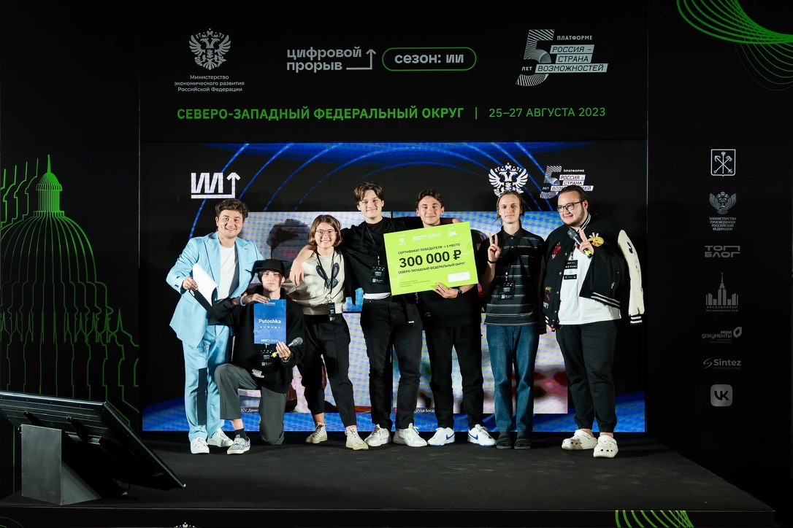
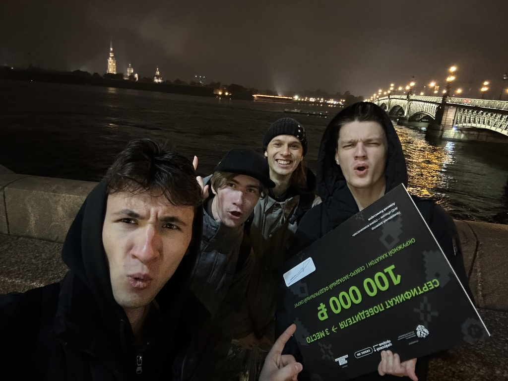
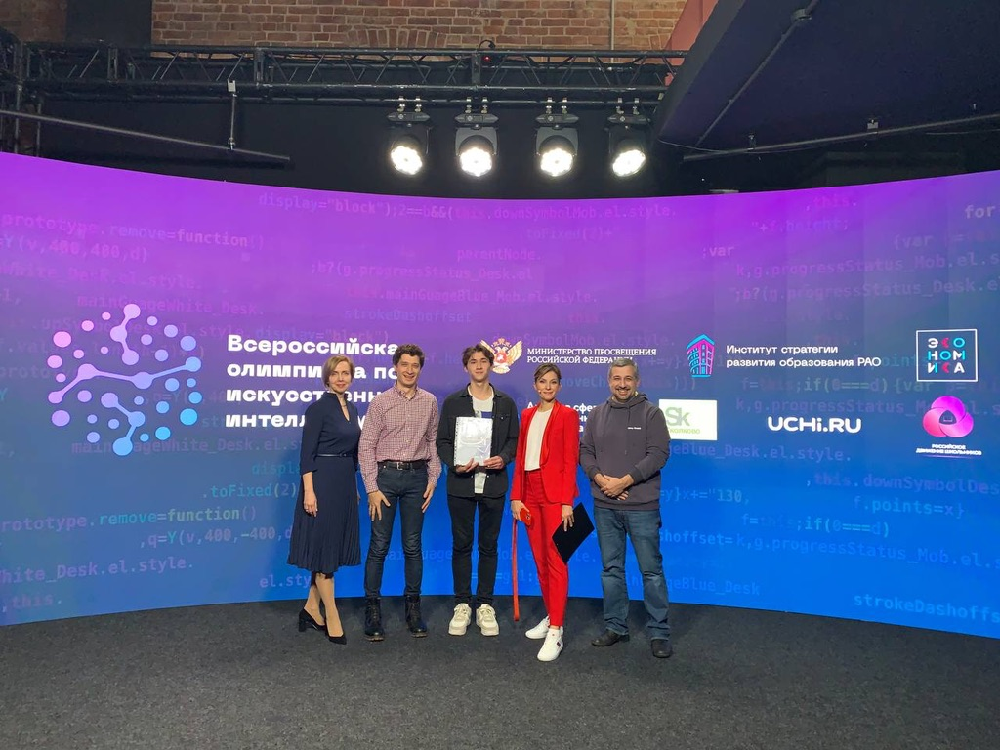
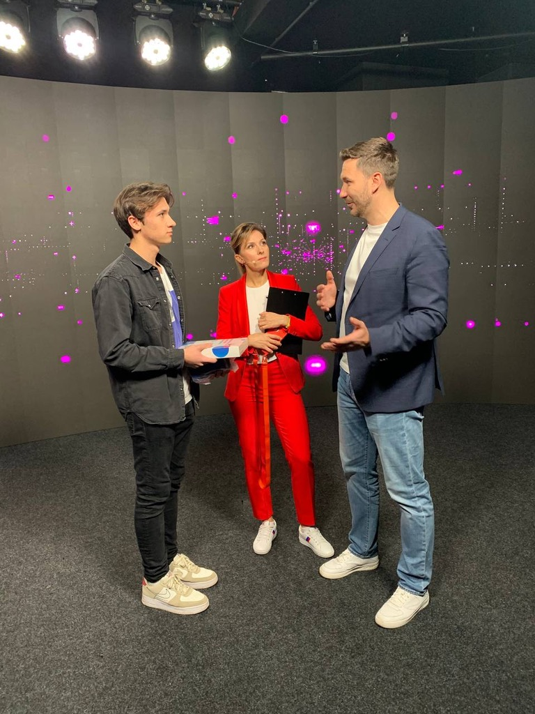
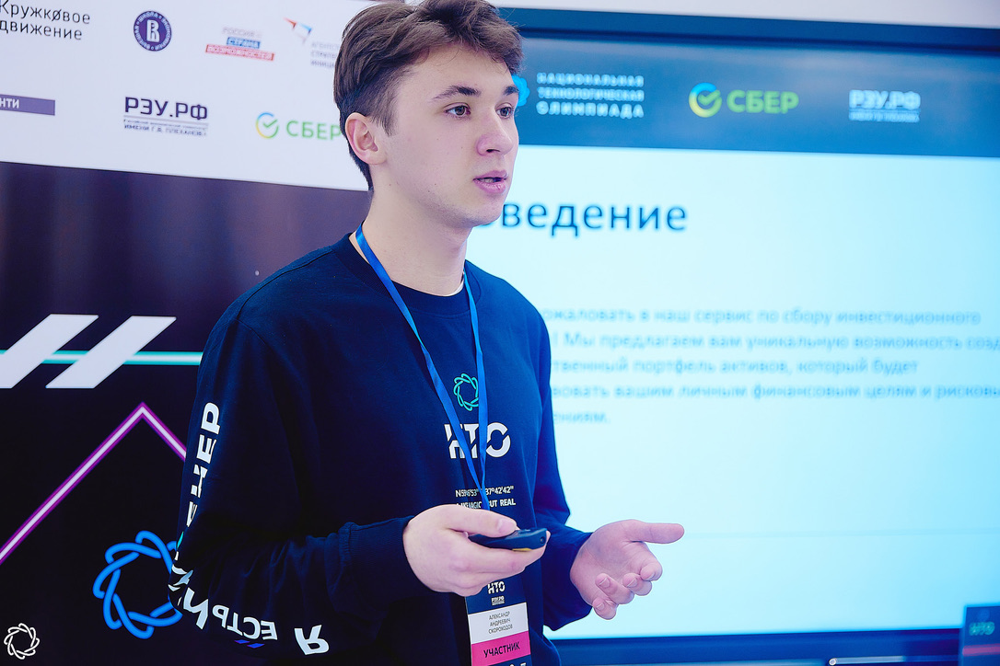
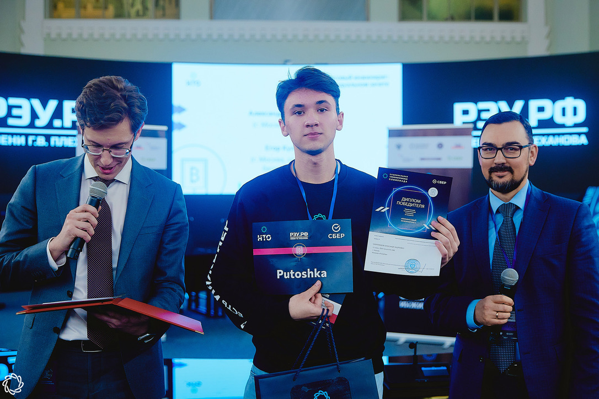
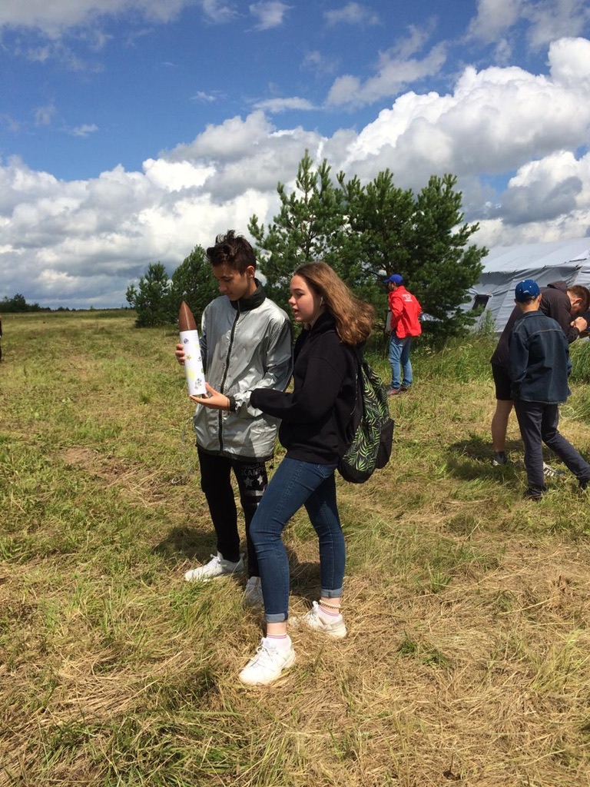
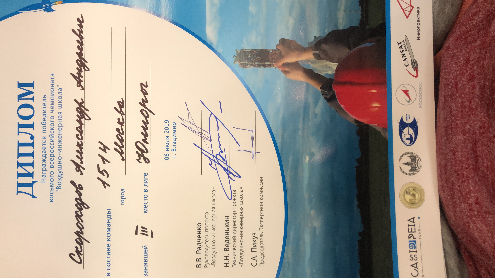

# Alexander Skorokhodov

**Independent AI Systems Engineer · Business & Engineering Automation**

I design and build software that improves real business processes — from understanding the workflow and prototyping a solution to integrating it with existing systems.

My work combines applied AI, backend engineering, reliable automation and human-centered interfaces.

[LinkedIn](https://www.linkedin.com/in/alexander-skorokhodov/) · [Telegram](https://t.me/alexanderbtw) · [Threads](https://www.threads.com/@aa_skorohodov)

[Project portfolio](projects/README.md) · [Engineering notes](notes/README.md) · [Research](research/README.md)

## Selected engineering results

<table>
<tr>
<td align="center"><b>30 → 5 min</b> Report preparation</td>
<td align="center"><b>250–800</b> Internal requests per month</td>
<td align="center"><b>200</b> Browser actions per task</td>
<td align="center"><b>500+</b> Market instruments</td>
</tr>
</table>

## Selected work

### Business Operations Platform

**Workflow automation · Internal operations**

Built an internal platform to centralize operational requests, define responsibilities and make work status visible.

- Centralized workflows for 14 employees.
- Processes 250–800 internal requests per month.
- Models roles, statuses, transitions and deadlines.
- Reduced status preparation from approximately 30 minutes to 5 minutes.

`Python` `FastAPI` `PostgreSQL` `React`

### Secure Browser Agent Runtime

**AI agents · Reliable execution**

Built a runtime for multi-step browser tasks in isolated Linux sessions, with explicit execution state, recovery and completion checks.

- Supports tasks containing up to 200 browser actions.
- Separates planning, execution, state, verification and recovery.
- Provides human handoff for CAPTCHA, 2FA and sensitive actions.
- Keeps credentials outside LLM context, logs and artifacts.

`Python` `asyncio` `FastAPI` `PostgreSQL` `Docker` `React`

[Architecture case study →](https://github.com/alexanderskorokhodov/secure-web-agent-architecture)

### Exchange Data Infrastructure

**Real-time data · Distributed systems**

Built infrastructure for collecting and processing market data across multiple exchanges through a unified integration layer.

- 500+ market instruments across 15 exchanges.
- Peak incoming traffic up to 300 Mbit/s.
- Unified REST and WebSocket integrations, rate limiting, retry/backoff and automatic reconnection.
- Trading execution services for eight exchanges.

`TypeScript` `WebSocket` `Redis` `Redpanda` `PostgreSQL`

[Engineering showcase →](https://github.com/alexanderskorokhodov/exchange-data-infrastructure-showcase)

## Applied AI & pilot directions

I am exploring focused software pilots around specific operational and engineering workflows. These are areas of development and investigation, not a list of completed deployments or confirmed client engagements.

| Direction | Workflow |
| --- | --- |
| **Engineering automation** | Technical requirements, equipment selection, specifications and quotation preparation |
| **Document intelligence** | Structured extraction, document comparison, requirements checking and source-backed retrieval |
| **Operations intelligence** | Inventory, logistics, accountability, and process visibility |
| **Claims automation** | Document review, warranty claims and exception handling |
| **Data & visual intelligence** | Forecasting, image-based data extraction and operational analytics |
| **Agent reliability & economics** | Agent evaluation, execution failures, cost analysis and human oversight |

I focus on demonstrating a narrow, testable workflow before expanding it into a production system. Where appropriate, I share case studies and demonstrations; commercial pilot source code and proprietary implementation details remain private.

## Engineering notes & research

I write about questions that arise while building software and working with AI agents, including what fails, what needs verification and what changes in practice.

Current topics:

- Software development beyond code generation: requirements, architecture, testing, review and delivery.
- Independent agent evaluation, failure recovery and evidence-backed completion.
- Research methods that separate accumulated information from validated knowledge.
- AI economics, resource efficiency and local-first systems.
- Human-centered interfaces and design engineering.
- Turning a business workflow into a measurable software pilot.

Follow my writing on [LinkedIn](https://www.linkedin.com/in/alexander-skorokhodov/) and [Threads](https://www.threads.com/@aa_skorohodov).

## Collaboration

I am interested in working directly with businesses and implementation partners on applied AI and software automation: understanding an existing workflow, validating a focused pilot, and integrating a useful solution into the company's systems.

If you have a process worth improving, [contact me on Telegram](https://t.me/alexanderbtw) or [LinkedIn](https://www.linkedin.com/in/alexander-skorokhodov/).

## Stack

**Backend:** Python, FastAPI, asyncio, SQLAlchemy, PostgreSQL, Redis 
**Distributed systems:** Redpanda, WebSocket, REST API, Docker 
**Frontend:** TypeScript, React 
**AI systems:** LLM agents, MCP, browser automation, human-in-the-loop

## Selected publications

- [The future of finance is already here — LinkedIn post · 25K+ views](https://www.linkedin.com/posts/alexander-skorokhodov_ai-finance-trading-activity-7451962949247852544-WHD8?utm_source=share&utm_medium=member_desktop&rcm=ACoAAF7rcOcBvLWYf--vL6xgYpsk8BeoJFJOrzw)
- [The AI era for everything is ending — Threads post · 96.5K+ views](https://www.threads.com/@aa_skorohodov/post/DWQ_AXNjPKq?xmt=AQG0VB9z3NQU4L59Zar6afGMKZzDu2cBl3qXqACWcFm-Sg)

## Hackathons & recognition

| Achievement | Result | Details / evidence                                                                                                                                                               |
|---|---|----------------------------------------------------------------------------------------------------------------------------------------------------------------------------------|
| **National Technology Olympiad** Financial Engineering · March 2023 | Winner | Winner of the Financial Engineering track at the National Technology Olympiad (NTO). [School announcement about the achievement →](https://lycu1580.mskobr.ru/edu-news/7597)  |
| **Digital Breakthrough AI** North-West Federal District · August 2023 | 1st place · team award of **₽300,000** | Project: Golf Trainer. Dates: 25–27 August 2023.                                                                                                                              |
| **Digital Breakthrough AI** North-West Federal District · October 2024 | 3rd place | Project: Laptop Defect Recognition & Moderation Platform. Computer-vision recognition of laptop defects with a platform for moderator review, validation and case management. |
| **All-Russian Olympiad in Artificial Intelligence** 6 December 2021 | 4th place in Russia · 1st place in Moscow | Invited to the official broadcast of the olympiad. [VK post about the result →](https://vk.ru/wall-181732473_796)                                                             |
| **Step into the Future** Computer Science · 2022 | Prize-winner | Recognition for achievement in computer science.                                                                                                                                 |
| **International Youth Scientific & Practical Congress “Oil and Gas Horizons”** | 1st place · technical section | Designed a local web application for an oil and gas company employee based on a **Lukoil** case. [VK post →](https://vk.ru/wall-181732473_1729)                               |
| **All-Russian Rocket Engineering Championship** Summer 2019 | 3rd place · Junior League | 8th All-Russian Championship “Air Engineering School”. 6 July 2019 · Vladimir · team 1514, Moscow.                                                                            |

Actively participated in hackathons and technology congresses, working on
practical cases for companies including **VK, Sber, Rosatom, Lukoil** and
**GeekBrains**.

Photos from competitions and engineering events

<table>
<tr>
<td colspan="2" align="center"></td>
</tr>
<tr>
<td colspan="2" align="center"><b>Digital Breakthrough AI · SZFO · 2023</b> Golf Trainer · 1st place</td>
</tr>
<tr>
<td align="center"></td>
<td align="center"></td>
</tr>
<tr>
<td colspan="2" align="center"><b>Digital Breakthrough AI · SZFO · 2024</b> Laptop defect recognition · 3rd place</td>
</tr>
<tr>
<td align="center"></td>
<td align="center"></td>
</tr>

<tr>
<td colspan="2" align="center"><b>All-Russian Olympiad in Artificial Intelligence · 2021</b> 4th place in Russia · 1st place in Moscow · invited to the official broadcast</td>
</tr>
<tr>
<td align="center"></td>
<td align="center"></td>
</tr>
<tr>
<td colspan="2" align="center"><b>National Technology Olympiad · Financial Engineering · 2023</b> Winner</td>
</tr>
<tr>
<td align="center"></td>
<td align="center"></td>
</tr>
<tr>
<td colspan="2" align="center"><b>All-Russian Rocket Engineering Championship · Summer 2019</b> 3rd place · Junior League</td>
</tr>
</table>

