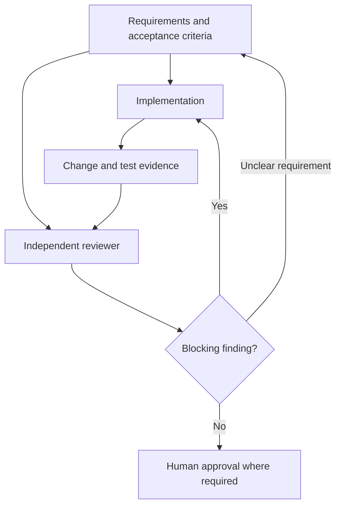

# Code is only one part of software development

*27 November 2026 · Software engineering · Methodology note*

Generating code is one stage of development. AI agents can help with that stage, but a working change still has to satisfy a real requirement, survive testing, fit the existing system and be safe to release.

The interesting engineering question is therefore not just how to generate code faster. It is how to organize the whole development process when implementation and review can both be assisted by agents.

## The development workflow

| Stage | Work to be done | Evidence before moving on |
| --- | --- | --- |
| Discovery | Understand the domain, existing process and actual problem | Examples of inputs, outputs and constraints |
| Requirements | Resolve ambiguity and define acceptance criteria | Explicit decisions, open questions and failure conditions |
| Design | Select architecture, contracts and integration boundaries | A design that explains its trade-offs |
| Implementation | Make a bounded change | A diff tied to the requirements |
| Verification | Test expected behavior, boundaries and regressions | Reproducible test results and unresolved failures |
| Review | Challenge assumptions, implementation and evidence | Findings with locations, impact and disposition |
| Release | Assess migration, rollout and rollback | Authorized release decision and operational checks |
| Feedback | Compare actual behavior with the intended outcome | Observations that inform the next change |

These are responsibilities rather than a mandatory waterfall. A failed test or a review question can send the work back to requirements or design. The important part is that the return path exists.

## Review is an engineering problem of its own

Giving an agent a diff and asking whether it looks good is not the same as establishing that the change is correct.

A useful review should have an explicit scope, the relevant requirements, a way to inspect the change, and criteria for accepting or rejecting a claim. A reviewer should be able to report uncertainty rather than produce a favorable verdict by default.

Different checks benefit from different mechanisms:

- Deterministic checks: tests, type checking, format validation and explicit invariants.
- Agent-assisted review: trace requirements to code, inspect edge cases, identify conflicting assumptions and propose reproducible failure scenarios.
- Human review: resolve ambiguous business requirements, assess meaningful security or operational risk, approve consequential changes.

These are complementary, not interchangeable. An agent finding is a hypothesis until it is supported by evidence or a clear logical counterexample. A passing test is evidence for the tested behavior, not a proof of total correctness.

## A proposed independent review loop

Independence here means separating the review objective from the implementation objective. It does not mean that another model is automatically more accurate. Reviewers can share the same blind spots, and a model can confidently invent a defect.

Start with inexpensive deterministic checks. Give the reviewer the minimum relevant evidence, ask for findings tied to concrete behavior, and reproduce important findings before accepting them. Add further review only when risk or uncertainty justifies the overhead.

## An illustrative example

Consider an internal request platform where users can change the status of a request. Suppose a requirement states that only an authorized role may complete a request.

The implementation agent may produce a working status update endpoint. A test may confirm the successful path. An independent review should also ask whether unauthorized requests are rejected, whether the same rule applies to every entry point, and whether a failed transition leaves the original state intact.

The example is synthetic. It describes questions to ask, not features verified in a particular deployed product.

## Measuring whether this helps

A reasonable evaluation would compare a baseline of tests plus ordinary review against tests plus independent agent-assisted review on the same bounded changes. Use seeded defects and a held-out set of cases; keep acceptance criteria fixed.

Track confirmed defects caught, false positives, reviewer time, total cost and escaped defects. Additional agents are useful only if their contribution justifies their cost and does not degrade the quality of decisions.

No comparative benchmark is presented in this note. The workflow is a proposed methodology, not a claim of measured productivity improvement.

## Related work

- [Secure Browser Agent — Architecture Case Study](https://github.com/alexanderskorokhodov/secure-web-agent-architecture): an existing public architecture example that separates execution from completion verification.
- [Business Operations Platform](../projects/business-operations/README.md): a public project brief about roles, statuses and operational workflows.

[All engineering notes](README.md) · [Project portfolio](../projects/README.md)
