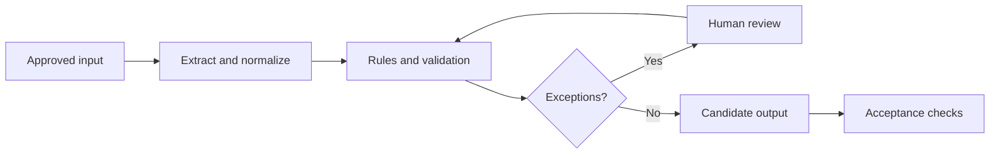

# From a business workflow to a software pilot

*27 November 2026 · Applied AI · Proposed methodology*

A useful pilot starts with a bounded business process rather than a model or a list of AI capabilities. Its purpose is to discover whether a specific workflow can be improved under real operational constraints. A successful demonstration alone does not establish production readiness or customer acceptance.

## Discover the unit of work

Choose a recognizable unit: a request, document, quotation or exception. Establish who initiates the work, what inputs are available, what decisions must be made, who owns the outcome and what counts as completion.

Public documentation can inform a preliminary hypothesis. Confirm actual requirements and exceptions with the process owner; do not infer buyer interest or permission to use data from a public request.

## Establish the baseline

| Question | Candidate measure |
| --- | --- |
| How long does work take? | Active handling time and end-to-end elapsed time |
| How often does work fail? | Rework and exceptions under agreed definitions |
| How much intervention is required? | Human review time and escalation frequency |
| Is the output usable? | Acceptance against agreed business rules |
| What does it cost? | Relevant execution, integration and review costs |

Without baseline data, benefit remains a hypothesis. Compare equivalent tasks under comparable conditions rather than extrapolating from a favorable example.

## Build a narrow vertical slice

Combine conventional software, deterministic rules, AI and human judgment according to the requirements of each stage. The simplest reliable mechanism should be the baseline. Provide a way to correct or reject uncertain model outputs.

Use authorized or synthetic inputs, cover a complete unit of work and include a meaningful failure path. Avoid broad integration investments before the central workflow hypothesis is tested.

## Synthetic example: technical document to structured request

A fictional business receives technical requests in documents and needs structured work items.

- Input: synthetic document containing identifiers, quantities, requirements and missing fields.
- Output: structured record, source references and unresolved fields.
- Validation: check required fields and flag inconsistent values.
- Human checkpoint: resolve missing or ambiguous information before acceptance.
- Evaluation: compare outputs with agreed references, track corrections and measure total handling time.

This is an illustrative workflow, not a customer deployment or a completed pilot.

## Decide whether to proceed

| Gate | Evidence |
| --- | --- |
| Problem fit | Confirmed workflow and accountable process owner |
| Functional fit | Agreed normal and exceptional scenarios evaluated |
| Operational fit | Human responsibilities, data boundaries and integration risks understood |
| Economic fit | Measured costs and benefits against the baseline |
| Production decision | Agreed scope, acceptance, security and operational responsibilities |

Proceed, narrow, redesign or stop according to the evidence. Real data access, commercial terms and production changes require separate agreement.

A technical evaluator should receive the workflow, architecture at an appropriate disclosure level, test scenarios, results with limitations and unresolved integration questions. Proprietary implementation and customer data need not be published.

No client-specific baseline, measured benefit or acceptance is asserted in this methodology note.

## Related work

- [Business Operations Platform](../projects/business-operations/README.md): public example of operational workflows and reported results.
- [Independent AI agent review](independent-ai-agent-review.md): proposed verification and review methodology.

[Engineering notes](README.md) · [Project portfolio](../projects/README.md)
