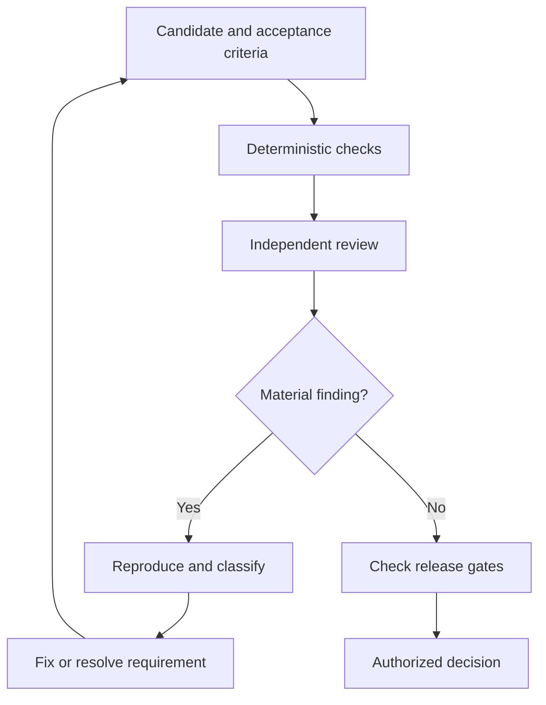

# Independent AI agent review

*27 November 2026 · Agent engineering · Proposed methodology*

A review process needs to discover defects, distinguish findings from noise and support an evidence-based release decision. Another agent's favorable opinion is not sufficient evidence of correctness.

## Separate responsibilities

| Role | Responsibility | Boundary |
| --- | --- | --- |
| Implementer | Produce a bounded change and test evidence | Cannot approve its own work merely by declaring success |
| Reviewer | Challenge the change against requirements | Cannot silently change the candidate or acceptance criteria |
| Verifier | Reproduce significant findings and run agreed checks | Reports failures and unavailable checks explicitly |
| Human decision-maker | Resolve ambiguous requirements and accept material residual risk | Owns authorization for consequential releases |

These are responsibilities, not necessarily four services. Start with the simplest process that preserves the necessary independence.

## Review contract

Provide the requirement, acceptance criteria, candidate revision, relevant diff and surrounding contracts, available test evidence, exclusions and risk level. Keep the revision stable while reviewing. Results from an older revision do not establish that a revised candidate passes.

Each finding should identify the affected requirement, location, triggering conditions, impact, evidence and proposed verification. Distinguish a confirmed defect, suspicion, design suggestion and unresolved requirement. Return unclear requirements to the appropriate decision-maker.

## Risk-based verification

| Change | Suggested depth |
| --- | --- |
| Documentation or bounded cosmetic change | Relevant checks and concise review |
| Business rules or API behavior | Requirement traceability, negative cases and regressions |
| Authorization, financial operations or migration | Independent verification, explicit failure scenarios and appropriate human approval |

## Synthetic example: retry behavior

Suppose a service creates a business record and a proposed change retries requests after a timeout. A reviewer should distinguish a failure before the operation takes effect from a response lost after the operation succeeds. Blindly repeating the latter request could create a duplicate. A verification case simulates the lost response and checks the agreed idempotency contract.

This is illustrative, not a disclosure of a customer system or a finding from a live review.

## Evaluate the reviewer

Compare ordinary review plus tests with the proposed agent-assisted process on comparable changes, using fixed acceptance criteria, seeded defects, clean changes and ambiguous requirements. Separate tuning cases from held-out evaluation cases.

Measure confirmed defects caught, missed seeded defects, false positives, review effort, time spent reproducing findings and total cost. Control for repeated attempts and model variability. Do not use comment count as a quality measure. Reject or simplify the additional review if its benefit does not justify its overhead.

No comparative benchmark has been executed for this note. Another model may share the implementer's blind spots; independence is a design property, not a guarantee of correctness.

## Related work

- [Code is only one part of software development](code-is-only-one-part.md).
- [Secure Browser Agent — architecture case study](https://github.com/alexanderskorokhodov/secure-web-agent-architecture): public example of separating execution and completion verification.

[Engineering notes](README.md) · [Project portfolio](../projects/README.md)
